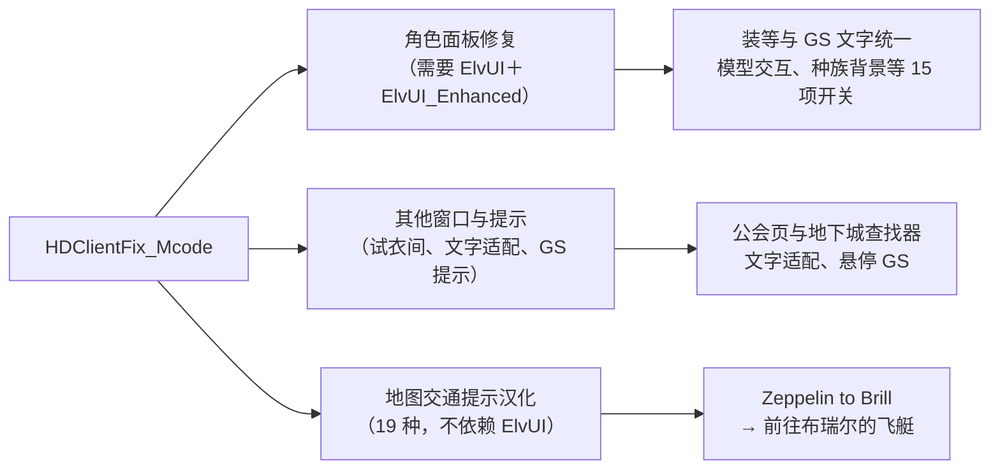

# Mcode HD 客户端修复（HDClientFix_Mcode）

 

合并原 `CharPanelFix_Mcode` 的角色与窗口修复，以及 `WDM_ZH_Mcode` 的 19 种地图交通提示汉化；已移除厄运之槌地图导航模块，室外图缩小与右键返回由配套汉化 MPQ 提供，不再新增地区菜单项。

## 打开设置

输入 `/hdfix`，或 **ESC → 界面 → 插件 → HD 客户端修复**。一个设置页按"角色面板""其他窗口与提示""地图"分组，每项保留独立开关，没有额外总开关。

## 安装与升级（首次改名安装）

1. 完全退出游戏与启动器。
2. 在 `Interface\AddOns\` 删除 `CharPanelFix_Mcode`、`WDM_ZH_Mcode` 和仍存在的 `Mcode_CharPanelFix` 目录，保留 WDM 本体、ElvUI 及其他依赖插件。
3. 安装完整的 `HDClientFix_Mcode` 目录（GitHub 下载 ZIP 后把 `-main` 后缀去掉），备份后完整替换，避免残留旧文件。
4. 完全重启游戏，启用插件并输入 `/hdfix` 检查依赖状态。

无需复制、改名或迁移旧插件存档；检测到旧插件冲突时聊天框分行提示一次，冲突只暂停对应模块。原 `/cpfix on/off/dump/reload` 命令继续可用。

## 依赖

- 主要角色面板修复：需要 ElvUI＋ElvUI_Enhanced，并启用其角色面板模块；不满足时不接管原有面板。
- 试衣间和文字适配：只需要 ElvUI。
- 自己的 GS 提示：依赖 GearScoreLite。
- 地图提示：不依赖 ElvUI，使用本 HD 客户端内置 WDM 1.0.5，不替换 WDM 本体。

## 反馈

角色面板仍有重叠、模型缺失或提示被遮挡时，输入 `/cpfix dump` 复制输出，附截图、角色、操作步骤和插件版本。

## 说明

- 角色面板修复作者 Mcode；地图提示汉化作者 MuyuQ。感谢提供截图和实测反馈的玩家。
- 完整玩家说明真源：工程 `doc/玩家/HD客户端修复说明.md`；成品 README 由刷新工具从真源生成。
- 两个旧插件的提交历史作为合并提交的父历史保留。
